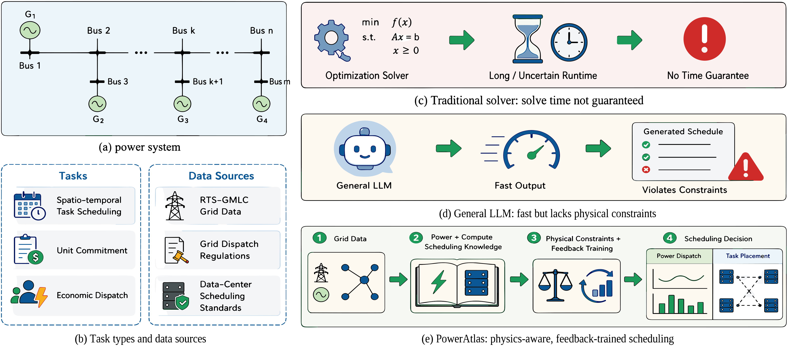

<div align="center">

# PowerAtlas: Towards Electricity-Computing Co-Scheduling for Power Systems

[](https://arxiv.org/abs/2607.26710)
[](LICENSE)

[**Paper**](https://arxiv.org/abs/2607.26710)
</div>

## Overview

Data centers are becoming large, volatile, yet spatiotemporally flexible grid loads, so generator
dispatch and computing-task placement are no longer separable problems. **PowerAtlas** is an
LLM-agent framework that answers both in one decision, and **ECBench** is the benchmark that scores
it against a Gurobi optimum. The framework has three parts:

- ⚡ **Coupled task and benchmark (ECBench)** — 2,000 instances built from the RTS-GMLC system and
  real data-center profiles, each paired with an oracle-optimal solution and scored on grid safety,
  computing satisfaction, economy, and efficiency.
- 🔍 **Deterministic verifier** — an hourly DC power-flow feasibility program replays the agent's own
  dispatch and placement, so a confident but infeasible schedule is charged exactly like a hesitant
  one. No solver is called at inference time.
- 🔄 **Feasibility-Aware GRPO (FA-GRPO)** — a format gate followed by a quality term that couples the
  compute and grid domains, turning the verifier's verdict into the training signal.

<p align="center">
  
</p>

## Performance

Held-out results per backbone, before and after PowerAtlas. Viol is the summed hourly grid violation
over the 24-hour horizon; S-cnt and S-val are the served fractions of task count and of
penalty-weighted value; Cost prices lost load at VOLL.

| Backbone | Viol (MWh) ↓ | S-cnt (%) ↑ | S-val (%) ↑ | Cost ($) ↓ |
|:---|---:|---:|---:|---:|
| Qwen3-4B-Instruct | 1,766.9 | 55.7 | 50.9 | 17,706,710 |
| &nbsp;&nbsp;**+ PowerAtlas** | **274.7** | **65.9** | **89.0** | **4,671,682** |
| Llama-3.2-3B-Instruct | 6,492.1 | 33.3 | 33.3 | 59,997,272 |
| &nbsp;&nbsp;**+ PowerAtlas** | **282.1** | **98.4** | **99.7** | **3,832,071** |
| Falcon3-3B-Instruct | 11,079.2 | 7.4 | 7.4 | 101,484,114 |
| &nbsp;&nbsp;**+ PowerAtlas** | **216.6** | **91.8** | **94.3** | **3,928,513** |

For reference, the strongest frontier baseline we measured leaves 445.8 MWh at \$6.07M on the same
instance, and the Gurobi optimum is reached in 16.8 s at the median but 148.1 s in the tail; a
PowerAtlas answer is one forward pass.

## Installation

```bash
git clone https://github.com/JAVA-Jiang/PowerAtlas.git
cd PowerAtlas

conda create -n poweratlas python=3.10 -y
conda activate poweratlas

pip install -r requirements.txt
```

Building ECBench needs a Gurobi licence (academic licences are free) and a copy of
[RTS-GMLC](https://github.com/GridMod/RTS-GMLC). Training was run on 2×A800 with PyTorch 2.6 /
vLLM 0.8.4; inference fits on a single 24 GB card.

## Project Structure

```
PowerAtlas/
├── ecbench/                      # the benchmark: instances, oracle, evaluator, metrics
│   ├── generate_instances.py     # RTS-GMLC + data-center profiles -> instances, solved to optimality
│   ├── evaluator.py              # grid-aware evaluator: replays the agent's own dispatch
│   ├── metrics.py                # Viol / satisfaction / cost / latency definitions
│   ├── build_prompts.py          # instances -> RL prompts (parquet)
│   ├── build_sft_targets.py      # oracle decisions -> warm-start targets
│   ├── build_retrieval_corpus.py # training-split corpus (no test instance can leak)
│   ├── build_knowledge.py        # domain-knowledge entries
│   └── to_hypergraph.py          # hypergraph index for the retriever
├── poweratlas/                   # the agent
│   ├── reward.py                 # FA-GRPO reward: format gate + coupled quality term
│   ├── infer_local.py            # greedy single-pass inference, no solver call
│   ├── infer_with_retrieval.py   # inference with in-context cases (training-time setting)
│   ├── eval_checkpoint.py        # checkpoint sweep on the held-out pool
│   └── merge_fsdp_ckpt.py        # FSDP shards -> HF checkpoint
├── baselines/
│   └── query_openai_compatible.py# frontier models through any OpenAI-compatible endpoint
├── configs/                      # the two training stages, as run on the cluster
│   ├── sft_eccs.sh
│   └── fagrpo_eccs.sh
├── scripts/                      # thin entry points
│   ├── build_dataset.sh
│   ├── train.sh
│   ├── evaluate.sh
│   └── run_baselines.sh
├── figures/                      # scripts that redraw the paper's figures
├── data/sample/                  # two instances with their oracle solutions, for a smoke test
├── assets/
├── requirements.txt
└── LICENSE
```

## Quick Start

### 0. Smoke test (no dataset, no GPU)

Two instances and their oracle solutions ship with the repository, together with the oracle decision
re-encoded as a prediction. Scoring it exercises the whole evaluation path:

```bash
export RTS_ROOT=/path/to/RTS-GMLC        # the evaluator loads the grid from here
python ecbench/evaluator.py --data_dir data/sample \
                            --pred_dir data/sample/pred_oracle --label oracle
```

Expected: the optimum comes back feasible on both instances — `Viol-MW = 0.03`, `S-cnt = 95.9%`,
and `1.02x` the oracle cost. The small residue is the percent rounding in the answer format, and is
the sanity margin against which model runs should be read.

### 1. Build ECBench

```bash
export RTS_ROOT=/path/to/RTS-GMLC
export ECBENCH_OUT=./dataset
bash scripts/build_dataset.sh
```

Each instance is solved to optimality with Gurobi and the run is resumable, so it can be interrupted
and restarted. `build_prompts.py` and `build_sft_targets.py` then turn the same instances into the
RL prompts and the warm-start targets; `build_retrieval_corpus.py` builds the corpus from the
training split only, so no test instance can leak into retrieval.

### 2. Train

```bash
bash scripts/train.sh sft        # Stage I : supervised initialization on oracle decisions
bash scripts/train.sh fagrpo     # Stage II: FA-GRPO with the verifier in the loop
```

Both stages run inside our Graph-R1 / verl fork; `configs/*.sh` are the scripts as we ran them on
2xA800 and expect that framework on the `PYTHONPATH`. `poweratlas/reward.py` is the reward the
second stage optimises and is self-contained enough to be dropped into another RL stack.

Retrieval is used during training rollouts only; the reported evaluations answer without in-context
cases, exactly as the baselines do.

### 3. Inference and evaluation

```bash
CKPT=checkpoints/falcon3-3b-fagrpo/step_40 PARQUET=./parquet/test.parquet bash scripts/infer.sh
DATA=./dataset PRED=./pred_run LABEL=falcon-fagrpo bash scripts/evaluate.sh
```

Inference is greedy, single pass, and never calls a solver. The evaluator reports Viol, the three
satisfaction rates, cost and the gap to the oracle, under both satisfaction conventions used in the
paper: the placement reading (was the service contract met) and the grid-aware reading (was the
task's own hour powered).

### 4. Frontier baselines

```bash
export API_KEY=...       # never hard-coded; also accepts DEEPSEEK_API_KEY
MODEL=deepseek-chat BASE_URL=https://api.deepseek.com bash scripts/run_baselines.sh
```

### 5. Figures

```bash
cd figures && python plot_panels.py    # reads figures/plot_data/, writes the Figure 5 panels
```

## Reproducibility

What this repository reproduces as-is: ECBench construction, the grid-aware evaluator and every
metric in the paper, the frontier baselines, and the figures. Given a checkpoint, the trained rows
of the results table can be re-scored end to end.

What it does not carry: the 2,000-instance dataset and the trained checkpoints (both too large for
git, and the data-center side of the benchmark is derived from a utility partner's facilities and is
released subject to their approval), and the training framework itself, which is our fork of
Graph-R1 / verl. Training therefore needs that fork plus `configs/*.sh`; everything downstream of a
checkpoint runs from this repository alone.

## Citation

If you find this work useful, please consider citing:

```bibtex
@article{jiang2026poweratlas,
  title={PowerAtlas: Towards Electricity-Computing Co-Scheduling for Power Systems},
  author={Jiang, Kaiwen and Xu, Siya and Zhu, Ziyue and Yang, Chao and Luu, Anh Tuan and Luo, Haoran},
  journal={arXiv preprint arXiv:2607.26710},
  year={2026}
}
```

## Acknowledgement

The training stack builds on [Graph-R1](https://github.com/LHRLAB/Graph-R1) and
[verl](https://github.com/volcengine/verl); instances are grounded in the
[RTS-GMLC](https://github.com/GridMod/RTS-GMLC) test system and solved with
[Gurobi](https://www.gurobi.com/). We thank their developers for the open-source work.

## License

Apache License 2.0 — see [LICENSE](LICENSE).
